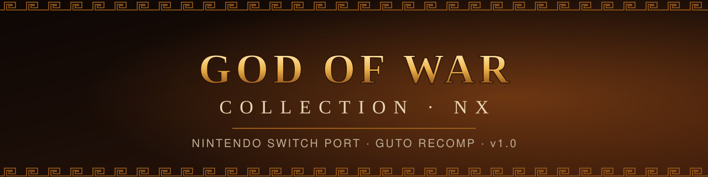

<div align="center">



# God of War Collection — NX Port

**Native port of *God of War* and *God of War II* (PS Vita) to Nintendo Switch**


[](https://ko-fi.com/gerissoncassiano)

🇧🇷 [Português](README.md) · 🇺🇸 **English** · 🇪🇸 [Español](README.es.md)

[About](#-about) · [Features](#-features) · [Graphics](#-graphics-deko3d-fsr-and-frame-generation) · [Performance](#-performance) · [Installation](#-installation) · [Add-ons](#-optional-add-ons) · [Controls](#-controls) · [Building](#%EF%B8%8F-building) · [Credits](#-credits) · [**Support**](#-support-the-project)

</div>

> [!IMPORTANT]
> **This repository contains neither the game nor any binaries built from it.** You need your own original copy of
> the PS Vita *God of War Collection* (US PKG **PCSA00126** + the `work.bin` license), and you build the NROs yourself
> by following [docs/BUILDING.md](docs/BUILDING.md).

---

## 📖 About

The PS Vita executables of *God of War* and *God of War II* are **statically recompiled** to C by the
[vitaRT](https://github.com/luisxl15/vitaRT) recompiler and then **compiled natively for the Switch's ARM64 CPU**.
**This is not an emulator:** there is no CPU interpretation or JIT. Only the Vita's system boundaries are reproduced
(kernel, files, audio, input and the GXM GPU).

The Vita's GPU (GXM) is translated to one of two renderers, picked in the options:

- **deko3d** — the Switch GPU's native API (Tegra X1, Maxwell). This is the recommended path: less CPU work per draw,
  and it is where **frame generation** and the new post-processing run.
- **Vulkan (NVK / Mesa)** — the port's original renderer, kept as a fallback.

This repository holds the **Switch layer** (libnx, deko3d, Vulkan, audio, input and threads), the **changes to the
vitaRT runtime** (as patches), the **launcher**, the **mod menu** and the build scripts.

## ✨ Features

| | |
|---|---|
| 🎮 **Native** | Game code recompiled to ARM64, no CPU emulation |
| 🟩 **deko3d renderer** | GXM translated straight to the Switch GPU's native API, with shaders converted ahead of time on PC (`shaders_dk.pak`) |
| 🔍 **AMD FSR 1.0** | EASU upscaler + adjustable RCAS sharpening (0 to 10) |
| 🎞️ **Frame generation (LSFG)** | 60 frames on screen with the game at 30, in *God of War* with deko3d |
| ⚡ **460 MHz GPU in handheld** | The official handheld performance profile, no overclock |
| 🎨 **Image** | FXAA, up to 16x anisotropic filtering, brightness, saturation, vibrance and debanding |
| 📺 **Handheld and TV** | Separate resolution per mode, switched automatically when docking |
| ⚔️ **Launcher** | Cover art, music, trophies, tabbed options, quick presets and a GitHub updater |
| 🛠️ **Mod menu (R + Plus)** | Graphics, mods, cheats and system settings while the game runs, no restart |
| 🏆 **Trophies** | Full list for both games, with progress, filters and spoiler-protected hidden trophies |
| 🌐 **Languages** | Launcher and mod menu in **Portuguese (BR)** and **English** |
| 🔊 **Stutter-free audio** | ATRAC9 decoded on the Switch and played through `audout` at its own priority |
| ⚙️ **Pause-menu options** | Internal resolution, frame rate, VSync, HD textures, PS2 audio, FPS counter and cheats* |
| 💾 **Saves and options on SD** | Everything in `sdmc:/switch/gow-nx/data/` |

<sub>* The extra pause-menu options come from the menu mod in
[GOD-OF-WAR-HD-COLLECTION](https://github.com/luisxl15/GOD-OF-WAR-HD-COLLECTION).</sub>

## 🎨 Graphics: deko3d, FSR and frame generation

### Renderer

In *Options → Image → Renderer* (or `renderer=` in `data/vitart_options.ini`):

| Value | What it does |
|---|---|
| `deko3d` | **Recommended.** Native GPU API. Needs `shaders/shaders_dk.pak`. Required for frame generation |
| `vulkan` | Vulkan through NVK. Uses only `shaders.pak` |
| `auto` | Lets the game choose (currently Vulkan) |

`shaders_dk.pak` is built on PC from `shaders.pak` (`tools/pack_shaders_dk.py`: SPIR-V → GLSL → DKSH). The game finds
each shader by its SPIR-V hash, so both packs must come from the same run. A shader missing from the pack is skipped
and logged, without crashing the game.

### Upscaler and image

| Option | `.ini` key | Values |
|---|---|---|
| Resolution (handheld) | `resolution_switch=` | auto, 1x (720x408), Vita (960x544), 720p, 2x, 3x, 4x |
| Resolution (TV) | `resolution_docked=` | the same; `0` = same as handheld |
| Upscaler | `upscaler=` | `bilinear` or `fsr1` (AMD FSR 1.0: EASU + RCAS) |
| Sharpness (RCAS) | `sharpness=` | 0 (off) to 10 |
| Anti-aliasing | `anti_aliasing=` | `off` or `fxaa` |
| Anisotropic filtering | `anisotropic=` | 1, 2, 4, 8, 16 |
| Brightness / Saturation | `gamma=` / `saturation=` | -4 to +4 on screen (`0` to `8` in the `.ini`, `4` = neutral) |
| Vibrance | `vibrance=` | 0 to 4 |
| Debanding | `debanding=` | on / off |

At 720p in handheld the image is already close to 1x: FSR skips the upscale pass and only applies sharpening, which
costs less GPU time.

### Frame generation

Uses **Lossless Scaling Frame Generation** through [lsfg-deko3d](https://github.com/NaGaa95/Cemu-nx) (from the Cemu-nx
project): for every real frame, compute passes build an in-between frame, and the screen shows **60 frames with the
game at 30**.

| Option | Key | Values |
|---|---|---|
| Frame generation | `frame_generation=` | `off`, `performance`, `quality` |
| Generation flow | `fg_flow=` | `1` full, `2` = 1/2 (default), `3` = 1/3, `4` = 1/4 |

- **Only in *God of War* (I)** and **only with the deko3d renderer**.
- A smaller optical flow is lighter. If a flow does not fit the chosen resolution, the game tries the next larger flow on
  its own; if the GPU runs past the frame budget, generation pauses for a few seconds and resumes when there is headroom.
- **The shaders do not ship with the port.** They come from the `Lossless.dll` of **your own** copy of *Lossless
  Scaling* (Steam), converted on PC by `tools/lsfg_prep` into `sdmc:/switch/gow-nx/lsfg/` (folders `Performance`,
  `Quality` and the `_f2`, `_f3`, `_f4` variants). Step by step in
  [docs/BUILDING.md](docs/BUILDING.md#geração-de-quadros-lsfg). Without that folder the option won't turn on and the
  log says why.

### Clocks

| Mode | CPU | GPU | Memory |
|---|---|---|---|
| Handheld | 1020 MHz | **460.8 MHz** (official handheld profile, held for the whole session) | 1331 MHz |
| Docked | 1020 MHz | 768 MHz (system default) | 1600 MHz |

This is not an overclock: it is the same performance profile retail games request from the system. The normal profile
comes back on exit. `VITART_GPU460=0` turns it off.

## 📊 Performance

Measured on real Switch hardware, handheld mode, no overclock.

| Game | Setup | Result |
|---|---|---|
| *God of War* | deko3d, 720p, FSR, frame generation (1/2 flow) | **30 game FPS → 60 on screen**; GPU ~23 ms per frame (scene ~9–10 ms, generation ~9.5–10 ms) |
| *God of War* | Vulkan, 720p, max FPS (v1.2, GPU 307 MHz) | ~45–60 FPS |
| *God of War II* | 1x, 30 FPS | steady 30 FPS in heavy scenes |

Resolutions above 720p (2x and up) are much heavier on the GPU; docked, the GPU goes up to 768 MHz on its own. The
history of each optimization is in [docs/PERFORMANCE.md](docs/PERFORMANCE.md).

## 📦 Requirements

- A Nintendo Switch running homebrew (Atmosphère + Homebrew Menu)
- Your copy of the PS Vita *God of War Collection* — **PCSA00126** (US) + `work.bin`
- About 4 GB free on the SD card
- Optional, for frame generation: your copy of *Lossless Scaling* (Steam) and a Windows PC

> [!TIP]
> Open the Homebrew Menu by **holding R while launching a game** (title takeover mode), not from the Album. Applet mode
> has far less memory and the game won't start. The launcher also needs the Homebrew Menu to start the games.

## 🚀 Installation

1. Build `gow-nx.nro`, `gow1.nro`, `gow2.nro`, `shaders.pak` and `shaders_dk.pak` with [docs/BUILDING.md](docs/BUILDING.md).
2. Copy them to the SD card:

```
sdmc:/switch/gow-nx/
├── gow-nx.nro          launcher (open this one)
├── gow1.nro            God of War
├── gow2.nro            God of War II
├── game/PCSA00126/     game files extracted from YOUR copy
├── shaders/            shaders.pak (SPIR-V) and shaders_dk.pak (deko3d)
├── lsfg/               optional: frame generation shaders, built from YOUR Lossless.dll
├── data/               options, saves, trophies and mods (created on first launch)
└── logs/               vitart_<game>.log and perfil_<game>.txt, for bug reports
```

3. Open **God of War Collection** from the Homebrew Menu, go to **Options → Image → Renderer**, pick **deko3d** and start
   the game.

### Updating

With the launcher open, press **−** to open the updater. It looks up the latest GitHub release, downloads
`gow-nx.zip` and installs the launcher, *God of War* and *God of War II* in one go, without touching `data/` (saves and
options), `game/`, `logs/` or `launcher.cfg`. Then press **A** to reopen the new launcher.

## 🧩 Optional add-ons

Everything below goes in `sdmc:/switch/gow-nx/data/`. Each add-on is optional; without it the game uses the original Vita assets.

### HD textures

One folder per game, with an `index.tsv` and the PNGs:

```
sdmc:/switch/gow-nx/data/texpack/
├── gow1/
│   ├── index.tsv      <texture key in hex><TAB><file.png>, one per line
│   └── *.png
└── gow2/
    ├── index.tsv
    └── *.png
```

- The key is the hash of the original Vita texture, so a pack is built for this port (a PCSX2 pack does not work as is: it has to be converted against the game files).
- Turn it on with **HD Textures** in the mod menu (**R + Plus**, **Mods** tab) or in the launcher options (**Game** tab) or in the pause menu **Options**, or set `hd_textures=1` in `data/vitart_options.ini`.
- On the Switch the decoded HD textures are capped at 384 MB of memory; very large packs load more slowly in new areas.

### PS2 audio

Replaces the Vita music, voices and effects with the PS2 version's audio. It needs files extracted from **your own** PS2 disc:

```
sdmc:/switch/gow-nx/data/
├── ps2audio.bin             God of War
├── ps2audio_files.idx
├── ps2audio_gow2.bin        God of War II
└── ps2audio_gow2_files.idx
```

- The same files from the PC version's `data` folder work here unchanged.
- Turn it on with **PS2 Audio** in the pause menu **Options**, or set `ps2_audio=1` in `data/vitart_options.ini`. Without the files the option shows *Unavailable*.

### HD videos (remastered cutscenes)

One folder per game, with the `.mp4` files and an `index.tsv`. **Without the `index.tsv` the folder is ignored.**

```
sdmc:/switch/gow-nx/data/videos/
├── gow1/
│   ├── index.tsv
│   └── Semo01.mp4, Semo01A.mp4, ...
└── gow2/
    ├── index.tsv
    └── IntroHUD.mp4, ColossusEye.mp4, ...
```

Each line of `index.tsv` is the name of the game's video (the `.bk2`, without extension), a **TAB** and the `.mp4` file. An optional third column is a delay in seconds, for a video that starts out of sync:

```
IntroHUD	IntroHUD.mp4
ColossusEye	ColossusEye.mp4
Semo01B	Semo01A.mp4	0.5
```

- H.264 or HEVC, decoded by the Switch's hardware decoder. **1280x720 at 30 fps** is the recommended format; 1440p/60 fps works but is much heavier.
- The game's own video keeps playing underneath (sound, skipping with X and the end of the scene are unchanged); only the picture is replaced.
- If a video does not show, check `logs/vitart_<game>.log` for the `cena remasterizada` lines.

## 🎮 Controls

**Launcher**

| Button | Action |
|---|---|
| **Left / Right** | Pick the game |
| **A** | Play |
| **Y** | Options (**Image**, **Color**, **Performance** and **Game** tabs) |
| **L / R** | Quick preset: **Performance** (Vita, 60 FPS), **Balanced** (720p, 60 FPS) or **Quality** (2x, 30 FPS) |
| **X** | Trophies |
| **−** | Updater |
| **+** | Exit |

In the options: **Up / Down** selects, **Left / Right** or **A** changes the value, **L / R** switches tabs, **X**
resets to default and **B** saves and goes back. In trophies: **L / R** switches game, **X** filters (all, earned,
missing) and **Y** reveals hidden ones.

**In game** (PS Vita layout on the Switch controller)

| Switch | Vita | | Switch | Vita |
|---|---|---|---|---|
| **B** | ✕ | | **L / R** | L / R |
| **A** | ○ | | **ZL / ZR** | L2 / R2 (rear triggers) |
| **Y** | □ | | **+** | Start |
| **X** | △ | | **−** | Select |
| Sticks | Sticks | | L3 / R3 | L3 / R3 |

The game's button icons use the Nintendo layout.

### Mod menu (hold **R** and press **+**)

Opens on top of the game, pauses it and applies everything right away, no restart:

| Tab | Options |
|---|---|
| **Graphics** | Quick preset, resolution (handheld and TV), upscaler, sharpness, anti-aliasing, anisotropic, brightness, saturation, vibrance, debanding, frame generation and flow |
| **Mods** | HD textures, enemy health bars, automatic QTEs |
| **Cheats** | Infinite health, magic and rage |
| **System** | Language, frame rate (30 / 60 / max), VSync, FPS counter, GPU diagnostics in the log, restore defaults, **exit game** |

The renderer (deko3d or Vulkan) can only be changed from the launcher, since the game has to restart. **Exit game**
asks for confirmation and closes cleanly back to the Homebrew Menu (anything not saved in-game is lost).

## 🛠️ Building

```sh
git clone https://github.com/gerisson1996/gow-collection-nx.git
git clone https://github.com/luisxl15/vitaRT.git
cd gow-collection-nx
VITART=../vitaRT bash scripts/setup.sh
GEN=/path/out/gen bash scripts/compile_mods.sh gow1 gow2 libc libfios2
VITART=../vitaRT VULKAN_INCLUDE=/path/Include GAME=gow1 bash scripts/build.sh
VITART=../vitaRT VULKAN_INCLUDE=/path/Include GAME=gow2 bash scripts/build.sh
python tools/pack_shaders_dk.py shaders.pak shaders_dk.pak      # deko3d shaders
bash launcher/build.sh
```

Needs devkitPro (devkitA64, libnx, **deko3d**, switch-freetype, switch-mpg123, switch-libwebp), NVK for Switch and, for
`shaders_dk.pak`, `spirv-cross` (Vulkan SDK) and `uam` (devkitPro). Frame generation is optional at build time
(`LSFG=` and `LSFG_GEN=`). The full walkthrough, including generating the code from your copy and the LSFG cache:
[docs/BUILDING.md](docs/BUILDING.md).

## 📚 Documentation

| Document | Contents |
|---|---|
| [CHANGELOG.en.md](CHANGELOG.en.md) | What changed in each version |
| [docs/BUILDING.md](docs/BUILDING.md) | Generating the code, building, deko3d shaders, LSFG cache and setting up the SD |
| [docs/USER_GUIDE.md](docs/USER_GUIDE.md) | Launcher, every option, mod menu, updater, clocks, saves and logs |
| [docs/PERFORMANCE.md](docs/PERFORMANCE.md) | Threads, optimizations and measured numbers |
| [docs/ARCHITECTURE.md](docs/ARCHITECTURE.md) | How the port works inside |
| [THIRD_PARTY_NOTICES.md](THIRD_PARTY_NOTICES.md) | Third-party licenses (deko3d, FSR, lsfg-deko3d, libwebp...) |
| [CONTRIBUTING.md](CONTRIBUTING.md) | How to contribute |

The detailed docs are in Portuguese.

## ☕ Support the project

The port is free and open source. The tools I use to make these ports are **paid**, and every donation helps keep
them and the project going. Want another game ported or an improvement? **Send your request with your donation**
(write it in the Ko-fi, PayPal or Pix message).

[](https://ko-fi.com/gerissoncassiano)
[](https://www.paypal.com/donate/?hosted_button_id=B3YTKT29F5ZLG)

Or via **PIX** (Brazil, e-mail key): `pocketneogames@gmail.com`


PIX copy-and-paste code:

```text
00020126460014br.gov.bcb.pix0124pocketneogames@gmail.com5204000053039865802BR5911RECOMP GUTO6006BRASIL62070503***63048D6B
```

## 🙏 Credits

- **[vitaRT](https://github.com/luisxl15/vitaRT)** and **[GOD-OF-WAR-HD-COLLECTION](https://github.com/luisxl15/GOD-OF-WAR-HD-COLLECTION)**
  — luisxl15: the static recompiler and PS Vita runtime this port builds on (not included here)
- **[devkitPro](https://devkitpro.org/)** — devkitA64, libnx and the Switch portlibs
- **[deko3d](https://github.com/devkitPro/deko3d)** — fincs: the Switch's native GPU API used by the new renderer
- **[AMD FidelityFX Super Resolution 1.0](https://github.com/GPUOpen-Effects/FidelityFX-FSR)** — EASU upscaler and RCAS sharpening
- **[lsfg-deko3d](https://github.com/NaGaa95/Cemu-nx)** (Cemu-nx project) — runs Lossless Scaling Frame Generation on deko3d; *Lossless Scaling* belongs to THS and the shaders come from each user's own copy
- **[Mesa / NVK](https://docs.mesa3d.org/drivers/nvk.html)** — the Vulkan driver used on Switch
- **[mvhoang92](https://github.com/mvhoang92)** — console testing and the diagnosis behind the v1.3 fixes (undrawn edge, FPS counter,
  *God of War II* shaders)
- Libraries: [libatrac9](https://github.com/Thealexbarney/LibAtrac9), [volk](https://github.com/zeux/volk),
  [mpg123](https://www.mpg123.de/), [FreeType](https://freetype.org/) — see
  [THIRD_PARTY_NOTICES.md](THIRD_PARTY_NOTICES.md)

## ⚖️ Legal notice

Unofficial fan project, not affiliated with or endorsed by Sony Interactive Entertainment, Santa Monica Studio or
Nintendo. *God of War* and PlayStation Vita are trademarks of Sony Interactive Entertainment; Nintendo Switch is a
trademark of Nintendo. **No game files are distributed:** use your own original copy. Do not share the game files or
the NROs, which are built from them.

The code in this repository is under the [MIT license](LICENSE). The patches in `patches/` modify vitaRT, which stays
under its author's terms, and third-party components keep their own licenses.
