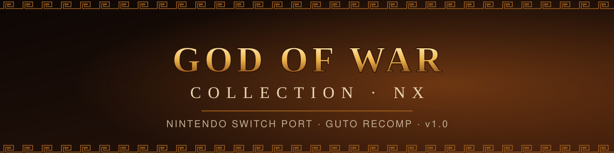

<div align="center">



# God of War Collection — NX Port

**Port nativo de *God of War* y *God of War II* (PS Vita) para Nintendo Switch**


[](https://ko-fi.com/gerissoncassiano)

🇧🇷 [Português](README.md) · 🇺🇸 [English](README.en.md) · 🇪🇸 **Español**

[Acerca de](#-acerca-de) · [Características](#-características) · [Gráficos](#-gráficos-deko3d-fsr-y-generación-de-fotogramas) · [Rendimiento](#-rendimiento) · [Instalación](#-instalación) · [Extras](#-extras-opcionales) · [Controles](#-controles) · [Compilar](#%EF%B8%8F-compilar) · [Créditos](#-créditos) · [**Apoyar**](#-apoya-el-proyecto)

</div>

> [!IMPORTANT]
> **Este repositorio no contiene el juego ni binarios generados a partir de él.** Necesitas tu propia copia original
> de *God of War Collection* de PS Vita (PKG estadounidense **PCSA00126** + la licencia `work.bin`) y generar los NRO
> tú mismo siguiendo [docs/BUILDING.md](docs/BUILDING.md).

---

## 📖 Acerca de

Los ejecutables de *God of War* y *God of War II* de PS Vita se **recompilan estáticamente** a C con el recompilador de
[vitaRT](https://github.com/luisxl15/vitaRT) y después se **compilan de forma nativa para el ARM64 de Switch**. **No es
un emulador:** no hay interpretación ni JIT de CPU. Solo se reproducen los bordes del sistema de Vita (kernel, archivos,
audio, controles y la GPU GXM).

La GPU de Vita (GXM) se traduce a uno de dos renderizadores, elegidos en las opciones:

- **deko3d** — la API nativa de la GPU de Switch (Tegra X1, Maxwell). Es el camino recomendado: menos trabajo de CPU
  por dibujo, y es donde funcionan la **generación de fotogramas** y el posprocesado nuevo.
- **Vulkan (NVK / Mesa)** — el renderizador original del port, mantenido como alternativa.

Este repositorio contiene la **capa de Switch** (libnx, deko3d, Vulkan, audio, entrada e hilos), los **cambios sobre el
runtime de vitaRT** (como parches), el **launcher**, el **mod menu** y los scripts de compilación.

## ✨ Características

| | |
|---|---|
| 🎮 **Nativo** | Código del juego recompilado a ARM64, sin emulación de CPU |
| 🟩 **Renderizador deko3d** | GXM traducido directo a la API nativa de la GPU de Switch, con shaders convertidos de antemano en el PC (`shaders_dk.pak`) |
| 🔍 **AMD FSR 1.0** | Upscaler EASU + nitidez RCAS ajustable (0 a 10) |
| 🎞️ **Generación de fotogramas (LSFG)** | 60 fotogramas en pantalla con el juego a 30, en *God of War* con deko3d |
| ⚡ **GPU a 460 MHz en portátil** | Perfil oficial de rendimiento del modo portátil, sin overclock |
| 🎨 **Imagen** | FXAA, filtro anisótropo hasta 16x, brillo, saturación, intensidad y debanding |
| 📺 **Portátil y TV** | Resolución separada para cada modo, cambiada sola al conectar al dock |
| ⚔️ **Launcher** | Portadas, música, trofeos, opciones en pestañas, presets rápidos y actualizador desde GitHub |
| 🛠️ **Mod menu (R + Plus)** | Gráficos, mods, trucos y sistema con el juego en marcha, sin reiniciar |
| 🏆 **Trofeos** | Lista completa de los dos juegos, con progreso, filtros y ocultos protegidos contra spoilers |
| 🌐 **Idiomas** | Launcher y mod menu en **portugués (BR)** e **inglés** |
| 🔊 **Audio sin tirones** | ATRAC9 decodificado en Switch y salida por `audout` con prioridad propia |
| ⚙️ **Opciones en el menú de pausa** | Resolución interna, tasa de fotogramas, VSync, texturas HD, audio de PS2, contador de FPS y trucos* |
| 💾 **Partidas y opciones en la SD** | Todo en `sdmc:/switch/gow-nx/data/` |

<sub>* Las opciones extra del menú de pausa vienen del mod de menú de
[GOD-OF-WAR-HD-COLLECTION](https://github.com/luisxl15/GOD-OF-WAR-HD-COLLECTION).</sub>

## 🎨 Gráficos: deko3d, FSR y generación de fotogramas

### Renderizador

En *Opciones → Imagen → Renderizador* (o `renderer=` en `data/vitart_options.ini`):

| Valor | Qué hace |
|---|---|
| `deko3d` | **Recomendado.** API nativa de la GPU. Necesita `shaders/shaders_dk.pak`. Necesario para la generación de fotogramas |
| `vulkan` | Vulkan a través de NVK. Usa solo `shaders.pak` |
| `auto` | Deja que el juego elija (hoy, Vulkan) |

`shaders_dk.pak` se genera en el PC a partir de `shaders.pak` (`tools/pack_shaders_dk.py`: SPIR-V → GLSL → DKSH). El
juego encuentra cada shader por el hash del SPIR-V, así que los dos paquetes deben salir de la misma ejecución. Un
shader que falte en el paquete se omite y se anota en el log, sin colgar el juego.

### Upscaler e imagen

| Opción | Clave en el `.ini` | Valores |
|---|---|---|
| Resolución (portátil) | `resolution_switch=` | automática, 1x (720x408), Vita (960x544), 720p, 2x, 3x, 4x |
| Resolución (TV) | `resolution_docked=` | las mismas; `0` = igual que en portátil |
| Upscaler | `upscaler=` | `bilinear` o `fsr1` (AMD FSR 1.0: EASU + RCAS) |
| Nitidez (RCAS) | `sharpness=` | 0 (desactivada) a 10 |
| Anti-aliasing | `anti_aliasing=` | `off` o `fxaa` |
| Filtro anisótropo | `anisotropic=` | 1, 2, 4, 8, 16 |
| Brillo / Saturación | `gamma=` / `saturation=` | -4 a +4 en pantalla (`0` a `8` en el `.ini`, `4` = neutro) |
| Intensidad | `vibrance=` | 0 a 4 |
| Debanding | `debanding=` | activado / desactivado |

A 720p en portátil la imagen ya está cerca de 1x: FSR se salta el escalado y solo aplica la nitidez, que cuesta menos
GPU.

### Generación de fotogramas

Usa **Lossless Scaling Frame Generation** mediante [lsfg-deko3d](https://github.com/NaGaa95/Cemu-nx) (del proyecto
Cemu-nx): por cada fotograma real, pasadas de compute crean un fotograma intermedio, y la pantalla muestra **60
fotogramas con el juego a 30**.

| Opción | Clave | Valores |
|---|---|---|
| Generación de fotogramas | `frame_generation=` | `off`, `performance`, `quality` |
| Flujo de la generación | `fg_flow=` | `1` completo, `2` = 1/2 (por defecto), `3` = 1/3, `4` = 1/4 |

- **Solo en *God of War* (I)** y **solo con el renderizador deko3d**.
- Un flujo óptico menor es más ligero. Si un flujo no cabe en la resolución elegida, el juego prueba solo el flujo mayor
  siguiente; si la GPU se pasa del tiempo de un fotograma, la generación se pausa unos segundos y vuelve cuando hay margen.
- **Los shaders no vienen con el port.** Salen del `Lossless.dll` de **tu** copia de *Lossless Scaling* (Steam),
  convertidos en el PC por `tools/lsfg_prep` a `sdmc:/switch/gow-nx/lsfg/` (carpetas `Performance`, `Quality` y las
  variantes `_f2`, `_f3`, `_f4`). Paso a paso en [docs/BUILDING.md](docs/BUILDING.md#geração-de-quadros-lsfg) (en
  portugués). Sin esa carpeta la opción no se activa y el log dice por qué.

### Relojes

| Modo | CPU | GPU | Memoria |
|---|---|---|---|
| Portátil | 1020 MHz | **460,8 MHz** (perfil oficial de portátil, mantenido toda la partida) | 1331 MHz |
| En TV | 1020 MHz | 768 MHz (por defecto del sistema) | 1600 MHz |

No es overclock: es el mismo perfil de rendimiento que piden los juegos comerciales al sistema. Al salir vuelve el
perfil normal. `VITART_GPU460=0` lo desactiva.

## 📊 Rendimiento

Medido en una Switch real, modo portátil, sin overclock.

| Juego | Configuración | Resultado |
|---|---|---|
| *God of War* | deko3d, 720p, FSR, generación de fotogramas (flujo 1/2) | **30 FPS del juego → 60 en pantalla**; GPU ~23 ms por fotograma (escena ~9–10 ms, generación ~9,5–10 ms) |
| *God of War* | Vulkan, 720p, FPS máximo (v1.2, GPU 307 MHz) | ~45–60 FPS |
| *God of War II* | 1x, 30 FPS | 30 FPS estables en las escenas pesadas |

Las resoluciones por encima de 720p (2x en adelante) pesan mucho más en la GPU; en TV la GPU sube a 768 MHz sola. La
evolución de cada optimización está en [docs/PERFORMANCE.md](docs/PERFORMANCE.md).

## 📦 Requisitos

- Nintendo Switch con homebrew (Atmosphère + Homebrew Menu)
- Tu copia de *God of War Collection* de PS Vita — **PCSA00126** (EE. UU.) + `work.bin`
- Unos 4 GB libres en la tarjeta SD
- Opcional, para la generación de fotogramas: tu copia de *Lossless Scaling* (Steam) y un PC con Windows

> [!TIP]
> Abre el Homebrew Menu **manteniendo R al abrir un juego** (modo title takeover), no desde el Álbum. En modo applet
> hay mucha menos memoria y el juego no arranca. El launcher también necesita el Homebrew Menu para iniciar los juegos.

## 🚀 Instalación

1. Genera `gow-nx.nro`, `gow1.nro`, `gow2.nro`, `shaders.pak` y `shaders_dk.pak` con [docs/BUILDING.md](docs/BUILDING.md).
2. Cópialos a la tarjeta SD:

```
sdmc:/switch/gow-nx/
├── gow-nx.nro          launcher (abre este)
├── gow1.nro            God of War
├── gow2.nro            God of War II
├── game/PCSA00126/     archivos del juego extraídos de TU copia
├── shaders/            shaders.pak (SPIR-V) y shaders_dk.pak (deko3d)
├── lsfg/               opcional: shaders de la generación de fotogramas, generados de TU Lossless.dll
├── data/               opciones, partidas, trofeos y mods (se crea en el primer arranque)
└── logs/               vitart_<juego>.log y perfil_<juego>.txt, para reportar problemas
```

3. Abre **God of War Collection** desde el Homebrew Menu, ve a **Opciones → Imagen → Renderizador**, elige **deko3d** y
   abre el juego.

### Actualizar

Con el launcher abierto, pulsa **−** para abrir el actualizador. Busca el último release de GitHub, descarga
`gow-nx.zip` e instala el launcher, *God of War* y *God of War II* de una vez, sin tocar `data/` (partidas y opciones),
`game/`, `logs/` ni `launcher.cfg`. Después pulsa **A** para reabrir el launcher nuevo.

## 🧩 Extras opcionales

Todo lo de abajo va en `sdmc:/switch/gow-nx/data/`. Cada extra es opcional; sin él el juego usa el contenido original de Vita.

### Texturas HD

Una carpeta por juego, con un `index.tsv` y los PNG:

```
sdmc:/switch/gow-nx/data/texpack/
├── gow1/
│   ├── index.tsv      <clave de la textura en hex><TAB><archivo.png>, una por línea
│   └── *.png
└── gow2/
    ├── index.tsv
    └── *.png
```

- La clave es el hash de la textura original de Vita, así que el pack se hace para este port (un pack de PCSX2 no funciona tal cual: hay que convertirlo con los archivos del juego).
- Actívalo en **HD Textures** en el mod menu (**R + Plus**, pestaña **Mods**) o en las opciones del launcher (pestaña **Juego**) o en **Options** del menú de pausa, o con `hd_textures=1` en `data/vitart_options.ini`.
- En Switch las texturas HD decodificadas están limitadas a 384 MB de memoria; los packs muy grandes cargan más lento en zonas nuevas.

### Audio de PS2

Cambia la música, las voces y los efectos de Vita por el audio de la versión de PS2. Necesita los archivos extraídos de **tu propio** disco de PS2:

```
sdmc:/switch/gow-nx/data/
├── ps2audio.bin             God of War
├── ps2audio_files.idx
├── ps2audio_gow2.bin        God of War II
└── ps2audio_gow2_files.idx
```

- Los mismos archivos de la carpeta `data` de la versión de PC funcionan aquí sin cambios.
- Actívalo en **PS2 Audio** en el menú de pausa (**Options**), o con `ps2_audio=1` en `data/vitart_options.ini`. Sin los archivos la opción aparece como *Unavailable*.

### Vídeos HD (cinemáticas remasterizadas)

Una carpeta por juego, con los `.mp4` y un `index.tsv`. **Sin el `index.tsv` la carpeta se ignora.**

```
sdmc:/switch/gow-nx/data/videos/
├── gow1/
│   ├── index.tsv
│   └── Semo01.mp4, Semo01A.mp4, ...
└── gow2/
    ├── index.tsv
    └── IntroHUD.mp4, ColossusEye.mp4, ...
```

Cada línea del `index.tsv` tiene el nombre del vídeo del juego (el `.bk2`, sin extensión), un **TAB** y el archivo `.mp4`. Una tercera columna opcional es un retraso en segundos, para un vídeo que empieza desincronizado:

```
IntroHUD	IntroHUD.mp4
ColossusEye	ColossusEye.mp4
Semo01B	Semo01A.mp4	0.5
```

- H.264 o HEVC, decodificados por el hardware de Switch. El formato recomendado es **1280x720 a 30 fps**; 1440p/60 fps funciona, pero es mucho más pesado.
- El vídeo del propio juego sigue reproduciéndose por debajo (sonido, saltar con X y el final de la escena no cambian); solo se cambia la imagen.
- Si un vídeo no aparece, mira las líneas `cena remasterizada` en `logs/vitart_<juego>.log`.

## 🎮 Controles

**Launcher**

| Botón | Acción |
|---|---|
| **Izquierda / Derecha** | Elegir el juego |
| **A** | Jugar |
| **Y** | Opciones (pestañas **Imagen**, **Color**, **Rendimiento** y **Juego**) |
| **L / R** | Preset rápido: **Rendimiento** (Vita, 60 FPS), **Equilibrado** (720p, 60 FPS) o **Calidad** (2x, 30 FPS) |
| **X** | Trofeos |
| **−** | Actualizador |
| **+** | Salir |

En las opciones: **Arriba / Abajo** elige, **Izquierda / Derecha** o **A** cambia el valor, **L / R** cambia de
pestaña, **X** vuelve al valor por defecto y **B** guarda y vuelve. En los trofeos: **L / R** cambia de juego, **X**
filtra (todos, obtenidos, pendientes) e **Y** muestra los ocultos.

<sub>El launcher está en portugués e inglés; los nombres de arriba son una traducción.</sub>

**En el juego** (distribución de PS Vita en el mando de Switch)

| Switch | Vita | | Switch | Vita |
|---|---|---|---|---|
| **B** | ✕ | | **L / R** | L / R |
| **A** | ○ | | **ZL / ZR** | L2 / R2 (gatillos traseros) |
| **Y** | □ | | **+** | Start |
| **X** | △ | | **−** | Select |
| Sticks | Sticks | | L3 / R3 | L3 / R3 |

Los iconos de botón del juego usan la distribución de Nintendo.

### Mod menu (mantén **R** y pulsa **+**)

Se abre sobre el juego, lo pausa y aplica todo al momento, sin reiniciar:

| Pestaña | Opciones |
|---|---|
| **Gráficos** | Preset rápido, resolución (portátil y TV), upscaler, nitidez, anti-aliasing, anisótropo, brillo, saturación, intensidad, debanding, generación de fotogramas y flujo |
| **Mods** | Texturas HD, barras de vida de los enemigos, QTE automático |
| **Cheats** | Vida, magia y furia infinitas |
| **Sistema** | Idioma, tasa de fotogramas (30 / 60 / máxima), VSync, contador de FPS, diagnóstico de GPU en el log, restaurar valores, **salir del juego** |

El renderizador (deko3d o Vulkan) solo se cambia desde el launcher, porque hay que reabrir el juego. **Salir del juego**
pide confirmación y cierra correctamente, volviendo al Homebrew Menu (lo que no se haya guardado en el juego se pierde).

## 🛠️ Compilar

```sh
git clone https://github.com/gerisson1996/gow-collection-nx.git
git clone https://github.com/luisxl15/vitaRT.git
cd gow-collection-nx
VITART=../vitaRT bash scripts/setup.sh
GEN=/ruta/out/gen bash scripts/compile_mods.sh gow1 gow2 libc libfios2
VITART=../vitaRT VULKAN_INCLUDE=/ruta/Include GAME=gow1 bash scripts/build.sh
VITART=../vitaRT VULKAN_INCLUDE=/ruta/Include GAME=gow2 bash scripts/build.sh
python tools/pack_shaders_dk.py shaders.pak shaders_dk.pak      # shaders de deko3d
bash launcher/build.sh
```

Requiere devkitPro (devkitA64, libnx, **deko3d**, switch-freetype, switch-mpg123, switch-libwebp), NVK para Switch y,
para `shaders_dk.pak`, `spirv-cross` (Vulkan SDK) y `uam` (devkitPro). La generación de fotogramas es opcional al
compilar (`LSFG=` y `LSFG_GEN=`). Guía completa, incluida la generación del código desde tu copia y la caché de LSFG:
[docs/BUILDING.md](docs/BUILDING.md) (en portugués).

## 📚 Documentación

| Documento | Contenido |
|---|---|
| [CHANGELOG.md](CHANGELOG.md) | Cambios por versión |
| [docs/BUILDING.md](docs/BUILDING.md) | Generar el código, compilar, shaders de deko3d, caché de LSFG y preparar la SD |
| [docs/USER_GUIDE.md](docs/USER_GUIDE.md) | Launcher, todas las opciones, mod menu, actualizador, relojes, partidas y logs |
| [docs/PERFORMANCE.md](docs/PERFORMANCE.md) | Hilos, optimizaciones y mediciones |
| [docs/ARCHITECTURE.md](docs/ARCHITECTURE.md) | Cómo funciona el port por dentro |
| [THIRD_PARTY_NOTICES.md](THIRD_PARTY_NOTICES.md) | Licencias de terceros (deko3d, FSR, lsfg-deko3d, libwebp...) |
| [CONTRIBUTING.md](CONTRIBUTING.md) | Cómo contribuir |

La documentación detallada está en portugués.

## ☕ Apoya el proyecto

El port es gratuito y de código abierto. Las herramientas que uso para hacer estos ports son **de pago**, y cada
donación ayuda a mantenerlas y a seguir con el proyecto. ¿Quieres otro juego portado o una mejora? **Envía tu pedido
junto con tu donación** (escríbelo en el mensaje de Ko-fi, PayPal o Pix).

[](https://ko-fi.com/gerissoncassiano)
[](https://www.paypal.com/donate/?hosted_button_id=B3YTKT29F5ZLG)

O por **PIX** (Brasil, clave e-mail): `pocketneogames@gmail.com`


PIX copia y pega:

```text
00020126460014br.gov.bcb.pix0124pocketneogames@gmail.com5204000053039865802BR5911RECOMP GUTO6006BRASIL62070503***63048D6B
```

## 🙏 Créditos

- **[vitaRT](https://github.com/luisxl15/vitaRT)** y **[GOD-OF-WAR-HD-COLLECTION](https://github.com/luisxl15/GOD-OF-WAR-HD-COLLECTION)**
  — luisxl15: el recompilador estático y el runtime de PS Vita en los que se basa este port (no incluidos aquí)
- **[devkitPro](https://devkitpro.org/)** — devkitA64, libnx y los portlibs de Switch
- **[deko3d](https://github.com/devkitPro/deko3d)** — fincs: la API nativa de la GPU de Switch usada por el renderizador nuevo
- **[AMD FidelityFX Super Resolution 1.0](https://github.com/GPUOpen-Effects/FidelityFX-FSR)** — upscaler EASU y nitidez RCAS
- **[lsfg-deko3d](https://github.com/NaGaa95/Cemu-nx)** (proyecto Cemu-nx) — ejecuta Lossless Scaling Frame Generation en deko3d; *Lossless Scaling* es de THS y los shaders salen de la copia de cada uno
- **[Mesa / NVK](https://docs.mesa3d.org/drivers/nvk.html)** — el driver Vulkan usado en Switch
- **[mvhoang92](https://github.com/mvhoang92)** — pruebas en la consola y el diagnóstico de las correcciones de la v1.3 (borde sin dibujar,
  contador de FPS, shaders de *God of War II*)
- Bibliotecas: [libatrac9](https://github.com/Thealexbarney/LibAtrac9), [volk](https://github.com/zeux/volk),
  [mpg123](https://www.mpg123.de/), [FreeType](https://freetype.org/) — ver
  [THIRD_PARTY_NOTICES.md](THIRD_PARTY_NOTICES.md)

## ⚖️ Aviso legal

Proyecto de fans, no oficial, sin relación con Sony Interactive Entertainment, Santa Monica Studio ni Nintendo, y sin
su respaldo. *God of War* y PlayStation Vita son marcas de Sony Interactive Entertainment; Nintendo Switch es marca de
Nintendo. **No se distribuye ningún archivo del juego:** usa tu propia copia original. No compartas los archivos del
juego ni los NRO, que se generan a partir de él.

El código de este repositorio está bajo la [licencia MIT](LICENSE). Los parches en `patches/` modifican vitaRT, que
sigue bajo los términos de su autor, y los componentes de terceros conservan sus propias licencias.
