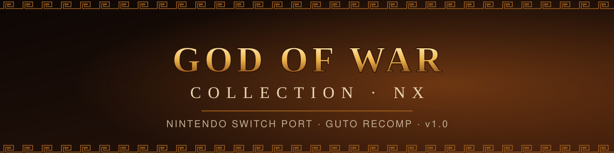

<div align="center">



# God of War Collection — NX Port

**Port nativo de *God of War* e *God of War II* (PS Vita) para Nintendo Switch**


[](https://ko-fi.com/gerissoncassiano)

🇧🇷 **Português** · 🇺🇸 [English](README.en.md) · 🇪🇸 [Español](README.es.md)

[Sobre](#-sobre) · [Recursos](#-recursos) · [Gráficos](#-gráficos-deko3d-fsr-e-geração-de-quadros) · [Desempenho](#-desempenho) · [Instalação](#-instalação) · [Extras](#-extras-opcionais) · [Controles](#-controles) · [Compilar](#%EF%B8%8F-compilar) · [Créditos](#-créditos) · [**Apoiar**](#-apoie-o-projeto)

</div>

> [!IMPORTANT]
> **Este repositório não contém o jogo nem binários dele.** Você precisa da sua própria cópia original da
> *God of War Collection* de PS Vita (PKG americano **PCSA00126** + a licença `work.bin`) e de gerar os NROs
> você mesmo, seguindo [docs/BUILDING.md](docs/BUILDING.md).

---

## 📖 Sobre

Os executáveis de *God of War* e *God of War II* do PS Vita são **recompilados estaticamente** para C pelo
recompilador do [vitaRT](https://github.com/luisxl15/vitaRT) e depois **compilados nativamente para o ARM64 do
Switch**. **Não é um emulador:** não há interpretação nem JIT de CPU. O que é reproduzido são as bordas do sistema
do Vita (kernel, arquivos, áudio, controles e a GPU GXM).

A GPU do Vita (GXM) é traduzida para um de dois renderizadores, escolhidos nas opções:

- **deko3d** — a API nativa da GPU do Switch (Tegra X1, Maxwell). É o caminho recomendado: menos trabalho de CPU por
  desenho e é nele que funcionam a **geração de quadros** e o pós-processamento novo.
- **Vulkan (NVK / Mesa)** — o renderizador original do port, mantido como alternativa.

Este repositório traz a **camada do Switch** (libnx, deko3d, Vulkan, áudio, entrada e threads), as **mudanças sobre o
runtime do vitaRT** (em forma de patches), o **launcher**, o **mod menu** e os scripts de compilação.

## ✨ Recursos

| | |
|---|---|
| 🎮 **Nativo** | Código do jogo recompilado para ARM64, sem emulação de CPU |
| 🟩 **Renderizador deko3d** | GXM traduzido direto para a API nativa da GPU do Switch, com shaders pré-convertidos no PC (`shaders_dk.pak`) |
| 🔍 **AMD FSR 1.0** | Upscaler EASU + nitidez RCAS ajustável (0 a 10) |
| 🎞️ **Geração de quadros (LSFG)** | 60 quadros na tela com o jogo a 30, no *God of War* com deko3d |
| ⚡ **GPU a 460 MHz no portátil** | Perfil oficial de desempenho do modo portátil, sem overclock |
| 🎨 **Imagem** | FXAA, filtro anisotrópico até 16x, brilho, saturação, vibrância e debanding |
| 📺 **Portátil e TV** | Resolução separada para cada modo, trocada sozinha ao encaixar na base |
| ⚔️ **Launcher** | Capas, música, troféus, opções em abas, presets rápidos e atualizador pelo GitHub |
| 🛠️ **Mod menu (R + Plus)** | Gráficos, mods, cheats e sistema com o jogo rodando, sem reiniciar |
| 🏆 **Troféus** | Lista completa dos dois jogos, com progresso, filtros e ocultos protegidos contra spoiler |
| 🌐 **Idiomas** | Launcher e mod menu em **português (BR)** e **inglês** |
| 🔊 **Áudio sem engasgos** | ATRAC9 decodificado no Switch e saída por `audout` com prioridade própria |
| ⚙️ **Opções no menu de pausa** | Resolução interna, taxa de quadros, VSync, texturas HD, áudio do PS2, contador de FPS e cheats* |
| 💾 **Saves e opções no SD** | Tudo em `sdmc:/switch/gow-nx/data/` |

<sub>* As opções extras do menu de pausa vêm do mod de menu do
[GOD-OF-WAR-HD-COLLECTION](https://github.com/luisxl15/GOD-OF-WAR-HD-COLLECTION).</sub>

## 🎨 Gráficos: deko3d, FSR e geração de quadros

### Renderizador

Em *Opções → Imagem → Renderizador* (ou `renderer=` em `data/vitart_options.ini`):

| Valor | O que faz |
|---|---|
| `deko3d` | **Recomendado.** API nativa da GPU. Precisa de `shaders/shaders_dk.pak`. Necessário para a geração de quadros |
| `vulkan` | Vulkan pelo NVK. Usa só o `shaders.pak` |
| `auto` | Deixa o jogo escolher (hoje, Vulkan) |

O `shaders_dk.pak` é gerado no PC a partir do `shaders.pak` (`tools/pack_shaders_dk.py`: SPIR-V → GLSL → DKSH). O
jogo acha cada shader pelo hash do SPIR-V, então os dois pacotes precisam ser da mesma rodada. Shader que faltar no
pacote é pulado e anotado no log, sem travar o jogo.

### Upscaler e imagem

| Opção | Chave no `.ini` | Valores |
|---|---|---|
| Resolução (portátil) | `resolution_switch=` | automática, 1x (720x408), Vita (960x544), 720p, 2x, 3x, 4x |
| Resolução (na TV) | `resolution_docked=` | os mesmos; `0` = igual ao portátil |
| Upscaler | `upscaler=` | `bilinear` ou `fsr1` (AMD FSR 1.0: EASU + RCAS) |
| Nitidez (RCAS) | `sharpness=` | 0 (desligada) a 10 |
| Anti-aliasing | `anti_aliasing=` | `off` ou `fxaa` |
| Filtro anisotrópico | `anisotropic=` | 1, 2, 4, 8, 16 |
| Brilho / Saturação | `gamma=` / `saturation=` | -4 a +4 na tela (`0` a `8` no `.ini`, `4` = neutro) |
| Vibrância | `vibrance=` | 0 a 4 |
| Debanding | `debanding=` | liga / desliga |

Em 720p no portátil a imagem já está perto de 1x: o FSR pula a ampliação e aplica só a nitidez, que custa menos GPU.

### Geração de quadros (frame gen)

Usa o **Lossless Scaling Frame Generation** pelo [lsfg-deko3d](https://github.com/NaGaa95/Cemu-nx) (do projeto Cemu-nx): a cada quadro
real, passadas de compute criam um quadro intermediário, e a tela mostra **60 quadros com o jogo a 30**.

| Opção | Chave | Valores |
|---|---|---|
| Geração de quadros | `frame_generation=` | `off`, `performance`, `quality` |
| Fluxo da geração | `fg_flow=` | `1` inteiro, `2` = 1/2 (padrão), `3` = 1/3, `4` = 1/4 |

- **Só no *God of War* (I)** e **só com o renderizador deko3d**.
- O fluxo óptico menor é mais leve. Se um fluxo não cabe na resolução escolhida, o jogo tenta sozinho o fluxo maior
  seguinte; se a GPU passa do tempo de um quadro, a geração pausa por alguns segundos e volta quando sobra folga.
- **Os shaders não vêm com o port.** Eles saem do `Lossless.dll` da **sua** cópia do *Lossless Scaling* (Steam),
  convertidos no PC pelo `tools/lsfg_prep` para `sdmc:/switch/gow-nx/lsfg/` (pastas `Performance`, `Quality` e as
  variantes `_f2`, `_f3`, `_f4`). O passo a passo está em [docs/BUILDING.md](docs/BUILDING.md#geração-de-quadros-lsfg). Sem essa pasta a opção não liga e o log diz o motivo.

### Relógios

| Modo | CPU | GPU | Memória |
|---|---|---|---|
| Portátil | 1020 MHz | **460,8 MHz** (perfil oficial do portátil, mantido a partida toda) | 1331 MHz |
| Na TV | 1020 MHz | 768 MHz (padrão do sistema) | 1600 MHz |

Não é overclock: é o mesmo perfil de desempenho que jogos comerciais pedem ao sistema. Ao sair, o perfil normal volta.
`VITART_GPU460=0` desliga.

## 📊 Desempenho

Medido no Switch real, modo portátil, sem overclock.

| Jogo | Configuração | Resultado |
|---|---|---|
| *God of War* | deko3d, 720p, FSR, geração de quadros (fluxo 1/2) | **30 FPS do jogo → 60 na tela**; GPU ~23 ms por quadro (cena ~9–10 ms, geração ~9,5–10 ms) |
| *God of War* | Vulkan, 720p, FPS máximo (v1.2, GPU 307 MHz) | ~45–60 FPS |
| *God of War II* | 1x, 30 FPS | 30 FPS estáveis nas cenas pesadas |

Resoluções acima de 720p (2x em diante) pesam bem mais na GPU; na TV a GPU sobe para 768 MHz sozinha. A evolução de
cada otimização está em [docs/PERFORMANCE.md](docs/PERFORMANCE.md).

## 📦 Requisitos

- Nintendo Switch com homebrew (Atmosphère + Homebrew Menu)
- Sua cópia da *God of War Collection* de PS Vita — **PCSA00126** (EUA) + `work.bin`
- Uns 4 GB livres no cartão SD
- Opcional, para a geração de quadros: sua cópia do *Lossless Scaling* (Steam) e um PC com Windows

> [!TIP]
> Abra o Homebrew Menu **segurando R enquanto abre um jogo** (modo title takeover), e não pelo Álbum. No modo
> applet a memória é bem menor e o jogo não abre. O launcher também precisa do Homebrew Menu para iniciar os jogos.

## 🚀 Instalação

1. Gere `gow-nx.nro`, `gow1.nro`, `gow2.nro`, `shaders.pak` e `shaders_dk.pak` com [docs/BUILDING.md](docs/BUILDING.md).
2. Copie para o cartão SD:

```
sdmc:/switch/gow-nx/
├── gow-nx.nro          launcher (abra este)
├── gow1.nro            God of War
├── gow2.nro            God of War II
├── game/PCSA00126/     arquivos do jogo extraídos da SUA cópia
├── shaders/            shaders.pak (SPIR-V) e shaders_dk.pak (deko3d)
├── lsfg/               opcional: shaders da geração de quadros, gerados do SEU Lossless.dll
├── data/               opções, saves, troféus e mods (criada no primeiro início)
└── logs/               vitart_<jogo>.log e perfil_<jogo>.txt, para relatar problemas
```

3. Abra **God of War Collection** pelo Homebrew Menu, vá em **Opções → Imagem → Renderizador**, escolha **deko3d** e
   abra o jogo.

### Atualizando

Com o launcher aberto, aperte **−** para abrir o atualizador. Ele procura o último release do GitHub, baixa o
`gow-nx.zip` e instala o launcher, o *God of War* e o *God of War II* de uma vez, sem mexer em `data/` (saves e
opções), `game/`, `logs/` nem `launcher.cfg`. Depois aperte **A** para reabrir o launcher novo.

## 🧩 Extras opcionais

Tudo abaixo vai em `sdmc:/switch/gow-nx/data/`. Cada extra é opcional; sem ele o jogo usa o conteúdo original do Vita.

### Texturas HD

Uma pasta por jogo, com um `index.tsv` e os PNGs:

```
sdmc:/switch/gow-nx/data/texpack/
├── gow1/
│   ├── index.tsv      <chave da textura em hex><TAB><arquivo.png>, uma por linha
│   └── *.png
└── gow2/
    ├── index.tsv
    └── *.png
```

- A chave é o hash da textura original do Vita, então o pack é feito para este port (um pack do PCSX2 não funciona direto: precisa ser convertido com os arquivos do jogo).
- Ligue em **HD Textures** no mod menu (**R + Plus**, aba **Mods**) ou nas opções do launcher (aba **Jogo**) ou em **Options** no menu de pausa, ou com `hd_textures=1` em `data/vitart_options.ini`.
- No Switch as texturas HD decodificadas ficam limitadas a 384 MB de memória; packs muito grandes carregam mais devagar em áreas novas.

### Áudio do PS2

Troca a música, as vozes e os efeitos do Vita pelo áudio da versão de PS2. Precisa dos arquivos extraídos do **seu** disco de PS2:

```
sdmc:/switch/gow-nx/data/
├── ps2audio.bin             God of War
├── ps2audio_files.idx
├── ps2audio_gow2.bin        God of War II
└── ps2audio_gow2_files.idx
```

- Os mesmos arquivos da pasta `data` da versão de PC funcionam aqui sem mudar nada.
- Ligue em **PS2 Audio** no menu de pausa (**Options**), ou com `ps2_audio=1` em `data/vitart_options.ini`. Sem os arquivos a opção aparece como *Unavailable*.

### Vídeos HD (cenas remasterizadas)

Uma pasta por jogo, com os `.mp4` e um `index.tsv`. **Sem o `index.tsv` a pasta é ignorada.**

```
sdmc:/switch/gow-nx/data/videos/
├── gow1/
│   ├── index.tsv
│   └── Semo01.mp4, Semo01A.mp4, ...
└── gow2/
    ├── index.tsv
    └── IntroHUD.mp4, ColossusEye.mp4, ...
```

Cada linha do `index.tsv` tem o nome do vídeo do jogo (o `.bk2`, sem extensão), um **TAB** e o arquivo `.mp4`. Uma terceira coluna opcional é um atraso em segundos, para um vídeo que começa fora de sincronia:

```
IntroHUD	IntroHUD.mp4
ColossusEye	ColossusEye.mp4
Semo01B	Semo01A.mp4	0.5
```

- H.264 ou HEVC, decodificados pelo hardware do Switch. O formato recomendado é **1280x720 a 30 fps**; 1440p/60 fps funciona, mas é bem mais pesado.
- O vídeo do próprio jogo continua tocando por baixo (som, pular com X e o fim da cena não mudam); só a imagem é trocada.
- Se um vídeo não aparecer, veja as linhas `cena remasterizada` em `logs/vitart_<jogo>.log`.

## 🎮 Controles

**Launcher**

| Botão | Ação |
|---|---|
| **Esquerda / Direita** | Escolher o jogo |
| **A** | Jogar |
| **Y** | Opções (abas **Imagem**, **Cor**, **Desempenho** e **Jogo**) |
| **L / R** | Preset rápido: **Desempenho** (Vita, 60 FPS), **Equilibrado** (720p, 60 FPS) ou **Qualidade** (2x, 30 FPS) |
| **X** | Troféus |
| **−** | Atualizador |
| **+** | Sair |

Nas opções: **Cima / Baixo** escolhe, **Esquerda / Direita** ou **A** muda o valor, **L / R** troca de aba, **X** volta
ao padrão e **B** grava e volta. Nos troféus: **L / R** troca de jogo, **X** filtra (todos, ganhos, faltando) e **Y**
mostra os ocultos.

**No jogo** (layout do PS Vita no controle do Switch)

| Switch | Vita | | Switch | Vita |
|---|---|---|---|---|
| **B** | ✕ | | **L / R** | L / R |
| **A** | ○ | | **ZL / ZR** | L2 / R2 (gatilhos traseiros) |
| **Y** | □ | | **+** | Start |
| **X** | △ | | **−** | Select |
| Analógicos | Analógicos | | L3 / R3 | L3 / R3 |

Os ícones de botão do jogo aparecem com o layout da Nintendo.

### Mod menu (segure **R** e aperte **+**)

Abre por cima do jogo, pausa a partida e aplica tudo na hora, sem reiniciar:

| Aba | Opções |
|---|---|
| **Gráficos** | Preset rápido, resolução (portátil e TV), upscaler, nitidez, anti-aliasing, anisotrópico, brilho, saturação, vibrância, debanding, geração de quadros e fluxo |
| **Mods** | Texturas HD, barras de vida dos inimigos, QTE automático |
| **Cheats** | Vida, magia e fúria infinitas |
| **Sistema** | Idioma, taxa de quadros (30 / 60 / máxima), VSync, contador de FPS, diagnóstico da GPU no log, restaurar padrões, **sair do jogo** |

O renderizador (deko3d ou Vulkan) só muda pelo launcher, porque precisa reabrir o jogo. **Sair do jogo** pede
confirmação e fecha do jeito certo, voltando ao Homebrew Menu (o que não foi salvo no jogo se perde).

## 🛠️ Compilar

```sh
git clone https://github.com/gerisson1996/gow-collection-nx.git
git clone https://github.com/luisxl15/vitaRT.git
cd gow-collection-nx
VITART=../vitaRT bash scripts/setup.sh
GEN=/caminho/out/gen bash scripts/compile_mods.sh gow1 gow2 libc libfios2
VITART=../vitaRT VULKAN_INCLUDE=/caminho/Include GAME=gow1 bash scripts/build.sh
VITART=../vitaRT VULKAN_INCLUDE=/caminho/Include GAME=gow2 bash scripts/build.sh
python tools/pack_shaders_dk.py shaders.pak shaders_dk.pak      # shaders do deko3d
bash launcher/build.sh
```

Precisa do devkitPro (devkitA64, libnx, **deko3d**, switch-freetype, switch-mpg123, switch-libwebp), do NVK para
Switch e, para o `shaders_dk.pak`, do `spirv-cross` (Vulkan SDK) e do `uam` (devkitPro). A geração de quadros é
opcional na compilação (`LSFG=` e `LSFG_GEN=`). O passo a passo completo, incluindo a geração do código a partir da sua
cópia e o cache do LSFG: [docs/BUILDING.md](docs/BUILDING.md).

## 📚 Documentação

| Documento | Conteúdo |
|---|---|
| [CHANGELOG.md](CHANGELOG.md) | O que mudou em cada versão |
| [docs/BUILDING.md](docs/BUILDING.md) | Gerar o código, compilar, shaders do deko3d, cache do LSFG e montar o SD |
| [docs/USER_GUIDE.md](docs/USER_GUIDE.md) | Launcher, todas as opções, mod menu, atualizador, relógios, saves e logs |
| [docs/PERFORMANCE.md](docs/PERFORMANCE.md) | Threads, otimizações e números medidos |
| [docs/ARCHITECTURE.md](docs/ARCHITECTURE.md) | Como o port funciona por dentro |
| [THIRD_PARTY_NOTICES.md](THIRD_PARTY_NOTICES.md) | Licenças de terceiros (deko3d, FSR, lsfg-deko3d, libwebp...) |
| [CONTRIBUTING.md](CONTRIBUTING.md) | Como contribuir |

## ☕ Apoie o projeto

O port é grátis e o código é aberto. As ferramentas que uso para fazer estes ports são **pagas**, e cada doação
ajuda a mantê-las e a continuar o projeto. Quer ver outro jogo portado ou uma melhoria? **Faça seu pedido junto com
a sua doação** (escreva na mensagem do Ko-fi, do PayPal ou do Pix).

[](https://ko-fi.com/gerissoncassiano)
[](https://www.paypal.com/donate/?hosted_button_id=B3YTKT29F5ZLG)

Ou por **PIX** (chave e-mail): `pocketneogames@gmail.com`


PIX copia e cola:

```text
00020126460014br.gov.bcb.pix0124pocketneogames@gmail.com5204000053039865802BR5911RECOMP GUTO6006BRASIL62070503***63048D6B
```

## 🙏 Créditos

- **[vitaRT](https://github.com/luisxl15/vitaRT)** e **[GOD-OF-WAR-HD-COLLECTION](https://github.com/luisxl15/GOD-OF-WAR-HD-COLLECTION)**
  — luisxl15: o recompilador estático e o runtime do PS Vita em que este port se baseia (não incluídos aqui)
- **[devkitPro](https://devkitpro.org/)** — devkitA64, libnx e os portlibs do Switch
- **[deko3d](https://github.com/devkitPro/deko3d)** — fincs: a API nativa da GPU do Switch usada pelo renderizador novo
- **[AMD FidelityFX Super Resolution 1.0](https://github.com/GPUOpen-Effects/FidelityFX-FSR)** — upscaler EASU e nitidez RCAS
- **[lsfg-deko3d](https://github.com/NaGaa95/Cemu-nx)** (projeto Cemu-nx) — execução do Lossless Scaling Frame Generation no deko3d; o *Lossless Scaling* é de THS e os shaders vêm da cópia de cada um
- **[Mesa / NVK](https://docs.mesa3d.org/drivers/nvk.html)** — o driver Vulkan usado no Switch
- **[mvhoang92](https://github.com/mvhoang92)** — testes no console e diagnóstico das correções da v1.3 (borda sem desenho, contador de FPS,
  shaders do *God of War II*)
- Bibliotecas: [libatrac9](https://github.com/Thealexbarney/LibAtrac9), [volk](https://github.com/zeux/volk),
  [mpg123](https://www.mpg123.de/), [FreeType](https://freetype.org/) — detalhes em
  [THIRD_PARTY_NOTICES.md](THIRD_PARTY_NOTICES.md)

## ⚖️ Aviso legal

Projeto de fã, não oficial, sem ligação com a Sony Interactive Entertainment, a Santa Monica Studio ou a Nintendo,
e sem o apoio delas. *God of War* é marca da Sony Interactive Entertainment, PlayStation Vita é marca da Sony
Interactive Entertainment e Nintendo Switch é marca da Nintendo. **Nenhum arquivo do jogo é distribuído:** use a sua
própria cópia original. Não compartilhe os arquivos do jogo nem os NROs, que são gerados a partir dele.

O código deste repositório está sob a [licença MIT](LICENSE). Os patches em `patches/` modificam o vitaRT, que
continua sob os termos do autor, e os componentes de terceiros mantêm as próprias licenças.
